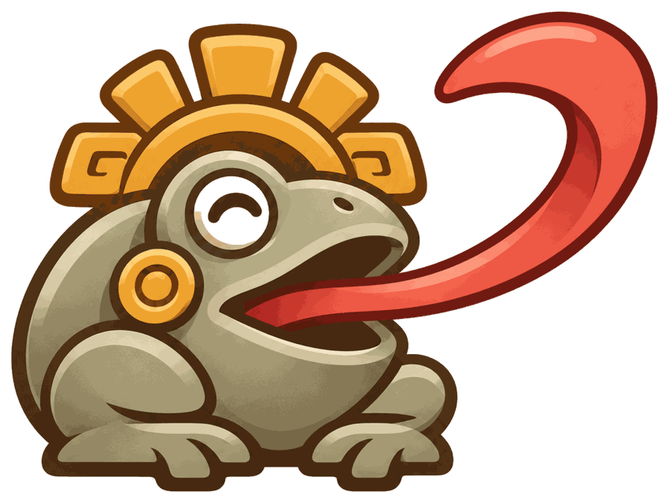

# RAGA — Own Your AI Context

**Your chats are not your memory. Turn them into a knowledge system you control.**

RAGA is a local-first, self-hostable, open-source project memory workspace. Capture an AI chat, transform useful conversation fragments into reviewable tasks and rules, manually create skills, organize decisions, and carry your context into a different model or coding agent.

**Stop rebuilding your project's memory every time your AI assistant resets.**

[Quick Start](#quick-start) · [Use Cases](#use-cases) · [API](#integration-api) · [Deployment](#deployment) · [Русский](#русский)

## Why RAGA?

**Build continuity. Reduce vendor lock-in. Own your knowledge.**

- **Portable context:** Save requirements, decisions, project facts, tickets and skills outside any one model provider's chat history or proprietary RAG store.
- **Human in control:** Manually write, edit, review and activate skills, rules and reusable instructions. You decide what is true and what matters.
- **Chat to work:** Convert human notes and long agent transcripts into project items instead of losing them as unstructured conversation.
- **Across AI providers:** Export compact project continuity as Markdown and supply it to another assistant, tool or workflow.
- **Humanities and research:** Organize long-form textual work for journalists, editors, historians, educators, social scientists, researchers and writers.
- **Private and personal:** Run the Community Core on your own laptop or workstation without external API keys.

RAGA reduces dependence on individual AI service vendors. It does not bypass proprietary providers' export restrictions; import only content you can access and reuse.

## Technical design and reference architecture

Explore how RAGA separates durable memory from model context, preserves source provenance and supports progressive access to full transcripts:

- **[Technical design — English](docs/TECHNICAL_DESIGN_EN.md)** — reference systems, internals, lexical/semantic/hybrid retrieval, data processing, context economy and current limitations.
- **[Техническая концепция — русский](docs/TECHNICAL_DESIGN_RU.md)** — принципы минимального контекста, векторизация, источники, архитектура и дальнейшее развитие.

## Use Cases

| Persona | What RAGA helps preserve |
| --- | --- |
| Vibe coder | Requirements, code decisions, errors and the next task when an AI coding session ends |
| Researcher | Working notes, source-based decisions and methods across projects |
| Writer and editor | Style rules, editorial procedures, drafts and reusable skills |
| AI developer | Portable project context exposed over an HTTP API |
| Local-first user | Personal memory that does not depend on a cloud chatbot's account |

## What Is Shipped

The current repository contains an independent **Community Core** with persistent conversation storage, source indexing, lexical and optional local vector/hybrid retrieval, manual knowledge management, recoverable projects, a web interface and optional local-model answers.

1. Create projects and import text chats, JSON exports, Markdown notes and supported ZIP archives.
2. Preserve original conversations and index overlapping source passages for retrieval.
3. Search passages using BM25-style lexical ranking with source and session references.
4. Detect possible tickets, rules, decisions and skills using transparent, reviewable heuristics.
5. Create and edit skills, rules, tickets, notes and decisions manually through the API or simple local interface.
6. Export active context, individual skills, or a complete project backup; restore the backup into a new empty project.
7. Optionally generate grounded answers with a locally running Ollama model. The default search and knowledge-management features need no LLM credentials.

**Limitations:** Extraction is heuristic and requires human review. Source retrieval defaults to lexical BM25-style scoring; local embedding-based retrieval can be enabled explicitly, without proprietary vectorization techniques. Optional local-model answers are not independently fact-checked. This edition does not ship the full original application, multi-user authentication, advanced agent orchestration or proprietary text-evaluation modules.

### Architecture

~~~text
AI chats / notes / agent transcripts
                |
         Project import API
                |
     Reviewable extracted items
     /       |       |       \
 Tickets   Rules   Skills  Decisions
     \       |       |       /
          Local storage
                |
      Search + edit + export
                |
       Any assistant or tool
~~~

## Quick Start

Requires Docker and Docker Compose.

~~~bash
git clone https://github.com/voodoo2serg/RAG_for_AI_RAGA.git
cd RAG_for_AI_RAGA
docker compose up --build -d
~~~

Open the **local web workspace at http://localhost:8000/**, interactive API documentation at **http://localhost:8000/docs**, and health check at **http://localhost:8000/api/health**. All ports are bound to localhost in the supplied Compose file.

Create a project:

~~~bash
curl -X POST http://localhost:8000/api/projects -H 'Content-Type: application/json' -d '{"name":"My AI project"}'
~~~

Import a chat or notes after replacing PROJECT_ID with the returned ID:

~~~bash
curl -X POST http://localhost:8000/api/projects/PROJECT_ID/sessions \
  -H 'Content-Type: application/json' \
  -d '{"source":"chat","content":"TODO: review the draft\nRule: check citations\nDecision: keep data local\nSkill: create a publication checklist"}'
~~~

Explore the resulting items in the **local web workspace at http://localhost:8000/** or using the interactive API docs. Edit skills and tasks using the PATCH endpoint and retrieve a continuity package through its endpoint.

### Search the imported source

~~~bash
curl -X POST http://localhost:8000/api/projects/PROJECT_ID/retrieve \
  -H 'Content-Type: application/json' \
  -d '{"query":"What did we decide about citations?","limit":5}'
~~~

The response contains ranked passages with source names, session IDs and chunk indices. Use these references to inspect the original material.

### Import exported files or archives

~~~bash
curl -F 'file=@notes.md' http://localhost:8000/api/projects/PROJECT_ID/upload
~~~

Supported types: UTF-8 TXT, MD, JSON, JSONL, CSV, LOG and ZIP archives of supported text files (size and count limits apply). The imported original text is preserved alongside searchable passages.

### Portable backup and restore

~~~bash
curl http://localhost:8000/api/projects/PROJECT_ID/backup -o project.json
# Create a new, empty project first and use the new project ID.
curl -X POST http://localhost:8000/api/projects/NEW_PROJECT_ID/restore \
  -H 'Content-Type: application/json' \
  --data-binary @project.json
~~~

This exports original session text, knowledge items and project metadata. Keep backup files private if conversations contain sensitive material.

## Deployment

### Personal Docker installation

~~~bash
docker compose up --build -d
docker compose ps
curl http://localhost:8000/api/health
docker compose logs -f raga
~~~

Stop without deleting your data with **docker compose down**. Do not use the volume-deletion flag unless you intend to erase the database. Your data is saved in the Docker volume.

### Install without Docker

Requires Python 3.12 or later:

~~~bash
python -m venv .venv
source .venv/bin/activate
pip install -r backend/requirements.txt
cd backend
uvicorn raga_community.api:app --host 127.0.0.1 --port 8000
~~~

On Windows PowerShell, activate the environment using the Scripts/Activate.ps1 script under .venv.

### Optional fully local LLM answers with Ollama

The default edition runs without any model. For optional local answers from retrieved passages:

~~~bash
docker compose --profile local-llm up --build -d
docker compose exec ollama ollama pull llama3.2
~~~

Then use the **Answer with local Ollama** control at http://localhost:8000/ or POST /api/projects/PROJECT_ID/ask with use_model=true and model=llama3.2. Model weights download on the first pull. The model runs locally when installed; its hardware requirements and generated output quality depend on your environment. Source passages are returned alongside answers.

### Optional local semantic / hybrid retrieval

This is a **standard open implementation of text embeddings and cosine similarity**; it does not include any proprietary RAGA-64 methods.

~~~bash
docker compose --profile local-llm up --build -d
docker compose exec ollama ollama pull nomic-embed-text
~~~

After importing sources, run POST /api/projects/PROJECT_ID/vectorize with a JSON body specifying model=nomic-embed-text. Then query POST /api/projects/PROJECT_ID/semantic-search with query, model and hybrid=true. The API stores ordinary vectors in the local database and combines semantic scores with lexical relevance. This straightforward implementation is intended for small personal projects, not millions of vectors.

### Security

This edition is designed for **single-user localhost use**. There is no multi-user account system. The API can optionally require a shared key through the RAGA_API_KEY environment variable and X-API-Key request header. The Community Core **must not be exposed directly to the public internet** without an appropriate authenticated gateway, network controls and additional hardening. Public internet deployment is outside this initial release's supported security boundary.

## Integration API

RAGA uses FastAPI and exposes OpenAPI documentation at /docs.

| Endpoint | Function |
| --- | --- |
| POST /api/projects | Create a project |
| GET /api/projects | List projects |
| POST /api/projects/{id}/sessions | Import a conversation |
| GET /api/projects/{id}/sessions | List imported sessions |
| GET /api/projects/{id}/items | View items and skills |
| POST /api/projects/{id}/items | Manually create a skill, rule, ticket, decision or note |
| PATCH /api/projects/{id}/items/{item_id} | Edit or change status |
| GET /api/projects/{id}/search | Search text |
| GET /api/projects/{id}/continuity | Export context as Markdown |
| POST /api/projects/{id}/upload | Import supported documents and ZIP archives |
| POST /api/projects/{id}/retrieve | Search indexed source passages with references |
| POST /api/projects/{id}/ask | Retrieve passages and optionally answer via local Ollama |
| POST /api/projects/{id}/reindex | Rebuild a project's lexical source index |
| POST /api/projects/{id}/restore | Restore a full project backup into an empty project |
| POST /api/projects/{id}/vectorize | Create local embedding vectors |
| POST /api/projects/{id}/semantic-search | Semantic or hybrid source retrieval |
| GET /api/projects/{id}/sessions/{session_id} | Retrieve original imported chat text |
| GET /api/projects/{id}/backup | Export full project, chats and knowledge as JSON |
| GET /api/projects/{id}/skills/{item_id}/markdown | Export a manually created skill as Markdown |

**Extension roadmap, not shipped:** scalable vector indexes, model-provider adapters beyond local Ollama, richer transcript parsers, visual project dashboards, multi-user roles, approvals and cross-agent automation. The current RAG feature uses local text indexing and optional Ollama, not the original private RAG engine.

## Separate Research Modules

RAGA developer **[voodoo2serg](https://github.com/voodoo2serg)** has also developed separate systems:

- **“Картина мира” / World Picture:** cultural and value-oriented analysis of text.
- **RAGA-64:** specialist tools and methods for optimizing vector representation of context.

Their implementation, deposited source and registration materials are **not included** and **not granted under this repository's license**. Contact the developer for information about availability.

## Why Is the Git History New?

The private development repository had **300 commits** at its inspected revision on **20 November 2026** and contained broader applications, experiments, integrations, documentation and tests. This public edition is deliberately a new, curated source distribution, separated from private research and infrastructure. A fresh Git history does **not** mean the idea or development began yesterday.

The historical 300 commits must not be confused with the test coverage or maturity of this independent Community Core. Assess this distribution using its own code and check results.

## Contributing and License

Built with Python, FastAPI and SQLite. Developers can contribute import adapters, tests, better retrieval, documentation and new integrations. Please open a focused issue and include reproducible examples.

Source code is licensed under **GNU GPL version 2 only — GPL-2.0-only**. See [LICENSE](LICENSE). Proprietary research components are outside this repository and license grant; third-party dependency licenses remain applicable.

**Discovery keywords:** AI memory, LLM memory, agent memory, context engineering, context management, RAG, retrieval augmented generation, self-hosted AI, local AI, chat history, vibe coding, coding agents, personal knowledge base, research tools, agent workflows, AI context portability, open source AI.

---

## Русский

### RAGA — управление контекстом, независимое от поставщика ИИ

**RAGA — открытая система управления контекстом и памятью проектов.** Она помогает сохранять чаты, превращать содержимое диалогов и агентных сессий в задачи, правила, решения и навыки, а затем использовать полученную базу знаний с другими ИИ-моделями.

**Главное преимущество — снижение зависимости от встроенных RAG-систем и памяти отдельных моделей и агентных платформ.** Пользователь хранит собственный контекст, вручную создаёт и редактирует скиллы, решает, какие правила считать действующими, и переносит знания между инструментами.

Для кого: вайбкодеры, разработчики, учёные, журналисты, редакторы, преподаватели, писатели и другие специалисты, работающие со сложными текстами и проектами.

**Что уже реализовано:** создание проектов, импорт переписок и файлов, сохранение оригинальных текстов, разбиение на поисковые фрагменты, лексический поиск и опциональный семантический/гибридный поиск через локальные эмбеддинги, извлечение задач, правил, решений и скиллов, ручное редактирование, резервное копирование и восстановление проектов. Дополнительно доступен ответ на вопрос через локальную Ollama на основе найденных фрагментов. Для базового режима платный ИИ не нужен.

**Локальная установка:**

~~~bash
git clone https://github.com/voodoo2serg/RAG_for_AI_RAGA.git
cd RAG_for_AI_RAGA
docker compose up --build -d
~~~

После запуска откройте **http://localhost:8000/docs**. В Community Core предусмотрены простая локальная веб-страница на http://localhost:8000/ и API для расширенных операций; это пока не полноценный графический кабинет приватной версии. По умолчанию программа рассчитана на одного локального пользователя и не должна открываться в интернет без дополнительной защиты.

Разработчик **voodoo2serg** также создал отдельную систему культурно-ценностного анализа текстов **«Картина мира»** и методы оптимизации векторизации контекста **RAGA-64**. Их код и регистрационные документы не входят в публичный репозиторий. Сведения о доступности можно запросить у разработчика.

Приватный исходный проект насчитывал **300 коммитов** на проверенной версии от 20 ноября 2026 года. Новая история Git относится к отдельной открытой редакции и не отражает полной истории разработки.

**Лицензия — GNU GPL v2 (GPL-2.0-only).** Открытый код можно изучать, изменять и распространять в соответствии с условиями лицензии. Исключённые закрытые модули в эту лицензию не входят.
